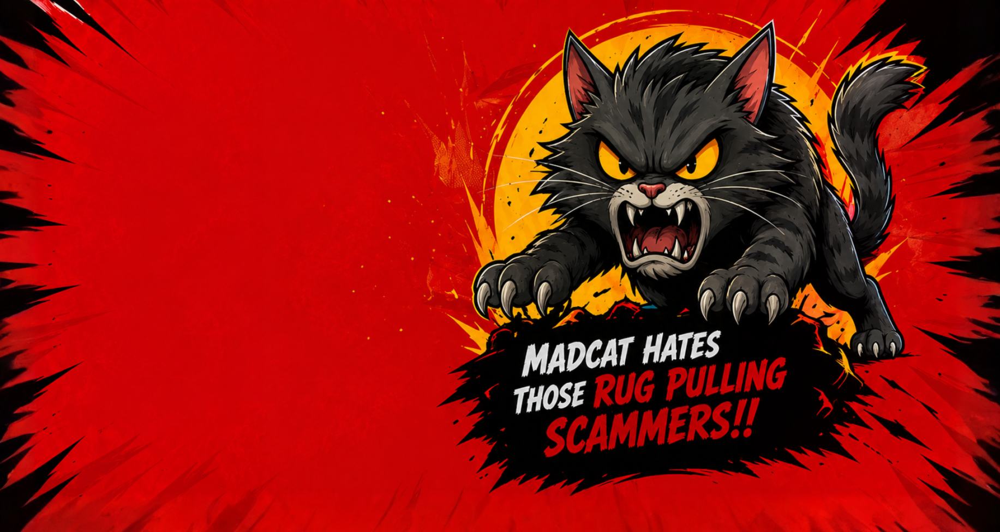

# 🐱 MADCAT — Built for the Pack

> **The Fiercest Solana Meme Coin Movement**  
> Aggressive by nature. Loyal to the community. Built to dominate the meme universe on Solana.

---



## 📌 Overview

**MADCAT** is a premium, high-energy meme coin platform built on the Solana blockchain. Designed with modern web standards, vibrant aesthetics, smooth micro-animations, and full mobile responsiveness, MADCAT delivers an unmatched user experience for holders, degens, and community members alike.

---

## 🔥 Key Features

- **⚡ High-Performance Hero Section**: Dynamic background artwork with responsive mobile layouts and magnetic CTA buttons.
- **📋 Smart Contract Address Bar**: One-click contract address copying with instant feedback and custom typography.
- **🎨 Interactive Tokenomics Pie Chart**: Built with custom SVG paths, dynamic donut cutout with MADCAT head artwork, and hover highlight effects.
  - 🔴 **40% Liquidity**
  - 🟡 **30% Community Rewards**
  - ⚪ **20% Marketing**
  - 🔘 **10% Development**
- **🗺️ Animated 4-Phase Roadmap**: Continuous glowing energy beam animation across timeline nodes using custom step icons (`LAUNCH`, `BUILD THE PACK`, `TAKE OVER`, `RULE THE MEME WORLD`).
- **🌐 Full Social CTA Hub**: Custom background art with mobile-optimized CTA buttons for Telegram, Twitter / X, and Raydium Buy Now.
- **🖤 Black Footer**: Includes mascot artwork, branding text, 3 circular social buttons, and structured navigation links.
- **🔄 Bi-Directional Scroll Animations**: Re-triggering scroll reveal animations on both scroll-up and scroll-down events via Framer Motion & Lenis smooth scroll.
- **🎯 Full SEO & OpenGraph**: Configured metadata, favicon (`face.png`), and social share cards (`hero-bg.png`).

---

## 🛠️ Tech Stack

| Technology | Purpose |
| :--- | :--- |
| **[Next.js 15 (App Router)](https://nextjs.org/)** | React Framework for SSG/SSR |
| **[React 19](https://react.dev/)** | UI Component Library |
| **[TypeScript](https://www.typescriptlang.org/)** | Type-Safe Development |
| **[Tailwind CSS v4](https://tailwindcss.com/)** | Utility-First Styling |
| **[Framer Motion](https://www.framer.com/motion/)** | Declarative Animations |
| **[GSAP](https://greensock.com/gsap/)** | Advanced Motion & ScrollTrigger |
| **[Lenis](https://lenis.darkroom.engineering/)** | Smooth Inertial Scroll |
| **[Lucide React](https://lucide.dev/)** | Icon Set |

---

## 🚀 Getting Started

### Prerequisites

- **Node.js**: `v18.0.0` or higher
- **npm** / **yarn** / **pnpm**

### Installation

1. **Clone the repository:**
   ```bash
   git clone https://github.com/ayanmal1k/MADCAT.git
   cd MADCAT
   ```

2. **Install dependencies:**
   ```bash
   npm install
   ```

3. **Run the development server:**
   ```bash
   npm run dev
   ```

4. **Open in browser:**  
   Navigate to [http://localhost:3000](http://localhost:3000) to view the live app.

---

## 🏗️ Production Build

To build the project for production:

```bash
npm run build
npm run start
```

---

## 📜 License

This project is licensed under the MIT License — see the [LICENSE](LICENSE) file for details.

---

<p align="center">
  <b>MADCAT Community © 2026. All Rights Reserved.</b><br/>
  <i>Disclaimer: MADCAT is a meme coin created for entertainment purposes only.</i>
</p>
